# MeterReadAI — Hệ Thống Đọc Chỉ Số Đồng Hồ Nước & Quản Lý Tính Tiền Nước Tự Động

<p align="center">
  
  
  
  
  
</p>

**MeterReadAI & WaterFlow** là giải pháp toàn diện kết hợp công nghệ **Thị giác Máy tính Hiện đại (Instance Segmentation & OCR)** với **Hệ thống Quản lý và Tính tiền nước tự động**. Dự án giải quyết trọn vẹn từ bài toán nhận diện tự động vùng mặt số và chỉ số đồng hồ nước thực tế tại Việt Nam đến quy trình vận hành tuyến đọc, lập hóa đơn bậc thang có bảo toàn snapshot minh bạch và cổng tra cứu dịch vụ cho khách hàng.

- 🎨 **Nguyên mẫu UI hoàn chỉnh (Google Stitch)**: [https://stitch.withgoogle.com/projects/3346993615529581711](https://stitch.withgoogle.com/projects/3346993615529581711)
- 🚀 **Mô hình cải tiến cốt lõi**: `c3k2stars` (YOLO11n-seg tích hợp StarNet C3k2_Star tại P3) & `asymmetric-inner-ciou`

---

## 📑 Mục lục
- [1. 🏗️ Kiến trúc & Thiết kế Hệ thống (System Design)](#1-️-kiến-trúc--thiết-kế-hệ-thống-system-design)
  - [1.1. Sơ đồ Ca sử dụng (Use Case Diagram)](#11-sơ-đồ-ca-sử-dụng-use-case-diagram)
  - [1.2. Sơ đồ Lớp Thực thể Nghiệp vụ (Class Diagram)](#12-sơ-đồ-lớp-thực-thể-nghiệp-vụ-class-diagram)
- [2. 🌐 Quy trình Thu thập & Gán nhãn Dữ liệu (Crawl & Labeling Pipeline)](#2--quy-trình-thu-thập--gán-nhãn-dữ-liệu-crawl--labeling-pipeline)
- [3. 📱 Thiết kế Giao diện Người dùng (19 Màn hình Stitch UI/UX)](#3--thiết-kế-giao-diện-người-dùng-19-màn-hình-stitch-uiux)
  - [3.1. Phân hệ Xác thực & Hồ sơ (Authentication & Profile)](#31-phân-hệ-xác-thực--hồ-sơ-authentication--profile)
  - [3.2. Cổng Thông tin Khách hàng (Customer Portal - WaterFlow)](#32-cổng-thông-tin-khách-hàng-customer-portal---waterflow)
  - [3.3. Ứng dụng Di động Nhân viên Ghi số (Meter Reader Mobile App)](#33-ứng-dụng-di-động-nhân-viên-ghi-số-meter-reader-mobile-app)
  - [3.4. Hệ thống Quản trị & Điều hành Doanh nghiệp (Admin Portal)](#34-hệ-thống-quản-trị--điều-hành-doanh-nghiệp-admin-portal)
- [4. 📊 Tổng quan Dataset](#4--tổng-quan-dataset)
  - [4.1. Bộ Dữ liệu Nhận diện Chữ số Đồng hồ Nước (OCR / Digit Datasets)](#41-bộ-dữ-liệu-nhận-diện-chữ-số-đồng-hồ-nước-ocr--digit-datasets)
- [5. 🔍 Khám phá & Đánh giá Dữ liệu (EDA)](#5--khám-phá--đánh-giá-dữ-liệu-eda)
- [6. 🛠️ Tiền xử lý & Trực quan hóa Dữ liệu](#6-️-tiền-xử-lý--trực-quan-hóa-dữ-liệu)
- [7. 🏆 Báo cáo Kết quả Đánh giá Mô hình Cơ sở (Baseline Models)](#7--báo-cáo-kết-quả-đánh-giá-mô-hình-cơ-sở-baseline-models)
  - [7.1. Phân đoạn Vùng Mặt số & Ký tự (Instance Segmentation Baseline)](#71-bảng-so-sánh-hiệu-năng-các-mô-hình-phân-đoạn-baseline-instance-segmentation)
  - [7.2. Nhận diện Chuỗi Chữ số OCR Baseline Sau Data Augmentation (CRNN vs. Tesseract)](#72-nhận-diện-chuỗi-chữ-số-ocr-baseline-sau-data-augmentation-crnn-vs-tesseract)
- [8. 🔬 Phân tích Lỗi Chuyên sâu (Error Analysis) & Động lực Cải tiến](#8--phân-tích-lỗi-chuyên-sâu-error-analysis--động-lực-cải-tiến)
- [9. 🚀 Kiến trúc Mô hình YOLO11 & Các Giải pháp Cải tiến (Enhanced Models)](#9--kiến-trúc-mô-hình-yolo11--các-giải-pháp-cải-tiến-enhanced-models)
  - [9.1. Tổng quan Kiến trúc YOLOv11](#91-tổng-quan-kiến-trúc-yolov11)
  - [9.2. Lý do Nhóm Lựa chọn YOLO11 làm Mô hình Chủ đạo](#92-lý-do-nhóm-lựa-chọn-yolo11-làm-mô-hình-chủ-đạo)
  - [9.3. Các Phương pháp Cải tiến Đột phá (C3k2_Star, Inner-CIoU, Inner-SIoU, Asymmetric Inner-CIoU)](#93-các-phương-pháp-cải-tiến-đột-phá-c3k2_star-inner-ciou-inner-siou-asymmetric-inner-ciou)
  - [9.4. Bảng So sánh Hiệu năng Toàn diện: Baseline vs. Các Mô hình Cải tiến](#94-bảng-so-sánh-hiệu-năng-toàn-diện-baseline-vs-các-mô-hình-cải-tiến)
  - [9.5. Đánh giá Tổng kết & Định hướng Ứng dụng Thực tế](#95-đánh-giá-tổng-kết--định-hướng-ứng-dụng-thực-tế)
- [10. 💻 Hướng dẫn Cài đặt & Huấn luyện Mô hình Cải tiến](#10--hướng-dẫn-cài-đặt--huấn-luyện-mô-hình-cải-tiến)
- [11. 📝 Ghi chú & Tài nguyên](#11--ghi-chú--tài-nguyên)

---

## 1. 🏗️ Kiến trúc & Thiết kế Hệ thống (System Design)

Hệ thống được thiết kế theo kiến trúc phân tầng hướng dịch vụ (Service-Oriented Architecture), phục vụ 3 nhóm tác nhân chính: **Khách hàng (Customer)**, **Nhân viên ghi số (Employee / Meter Reader)**, **Quản trị viên (Admin)** cùng với **AI Engine**.

### 1.1. Sơ đồ Ca sử dụng (Use Case Diagram)

Hệ thống phân định rõ trách nhiệm và luồng tương tác giữa các tác nhân:
- **Khách hàng (Customer)**: Đăng nhập/Đăng ký tài khoản, xem hóa đơn tiền nước, xem lịch sử tiêu thụ theo tháng, thanh toán trực tuyến qua cổng điện tử, đối soát bằng chứng ảnh chụp thực tế từ hiện trường, lập phiếu khiếu nại sai lệch chỉ số.
- **Nhân viên ghi số (Meter Reader)**: Tra cứu danh sách lộ trình/tuyến đọc được phân công, chụp ảnh hiện trường với camera hướng dẫn khung ngắm, nhận diện tức thì chỉ số qua AI Engine, xác nhận/điều chỉnh số đọc (lưu vết audit trail), báo cáo bất thường (hỏng hóc, mờ số, gian lận).
- **Hệ thống AI (AI Engine)**: Phân đoạn vùng mặt số (Instance Segmentation) và trích xuất chuỗi số (OCR) với độ tin cậy (*confidence score*), tự động cảnh báo khi độ tin cậy thấp hoặc chỉ số nghịch lý ($I_{mới} < I_{cũ}$).
- **Quản trị viên (Admin)**: Quản lý mạng lưới tuyến đọc, phân công nhân viên theo kỳ thu, thiết lập biểu giá nước bậc thang sinh hoạt/kinh doanh, phê duyệt & phát hành hóa đơn hàng loạt, theo dõi công nợ & giải quyết khiếu nại.

<p align="center">
  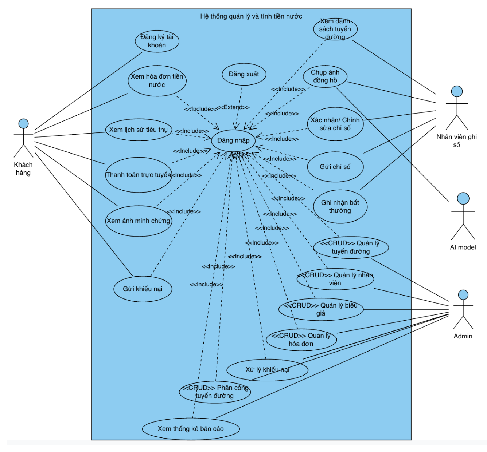
</p>
<p align="center">
  <em>Hình 1: Sơ đồ Use Case tổng thể của Hệ thống Quản lý và Tính tiền nước MeterReadAI</em>
</p>

---

### 1.2. Sơ đồ Lớp Thực thể Nghiệp vụ (Class Diagram)

Cấu trúc thực thể và quan hệ cơ sở dữ liệu được chuẩn hóa theo tiêu chuẩn **SQLAlchemy 2.0** (`Mapped[T]`, `mapped_column`), bảo đảm tính toàn vẹn dữ liệu và chuỗi bằng chứng (Audit Trail):

- **Module 1: User & Authentication**: Lớp trừu tượng `User` với các lớp kế thừa `Customer`, `Employee`, `Admin`; quản lý phân quyền RBAC và trạng thái `UserStatus`.
- **Module 2: Water Network & Meter Management**: Quản lý tuyến đường `Route`, lịch phân công `RouteAssignment`, và hồ sơ đồng hồ `WaterMeter` (mã hiệu, số seri, vị trí GPS, ngày lắp đặt).
- **Module 3: Meter Reading & AI Processing**: Thực thể `MeterReading` liên kết với ảnh hiện trường `MeterImage`, kết quả suy luận bất biến `AIRecognition` (lưu bounding box, polygon mask, confidence, predictedSequence chuỗi ký tự giữ nguyên số `0` ở đầu), và báo cáo sự cố `Abnormality`.
- **Module 4: Tariff & Invoicing Engine**: Cấu hình biểu giá bậc thang `Tariff`, `TariffTier`, hóa đơn `Invoice`, snapshot chi tiết từng bậc `InvoiceTierDetail` (bảo toàn công thức tính $q_j \times p_j$, thuế GTGT 5%, phí BVMT 10%), và giao dịch `Payment`.
- **Module 5: Complaints & Customer Support**: Quy trình tiếp nhận `Complaint` và bằng chứng đối soát `ComplaintEvidence`.

<p align="center">
  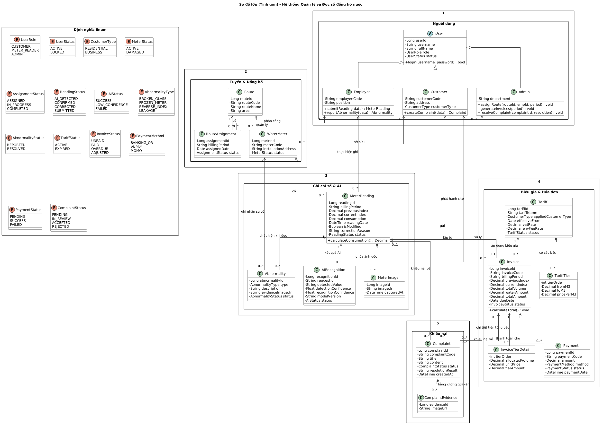
</p>
<p align="center">
  <em>Hình 2: Sơ đồ Lớp (Class Diagram) chuẩn hóa của hệ thống MeterReadAI & WaterFlow</em>
</p>

---

## 2. 🌐 Quy trình Thu thập & Gán nhãn Dữ liệu (Crawl & Labeling Pipeline)

Để đảm bảo mô hình AI hoạt động bền bỉ trong điều kiện môi trường khắc nghiệt tại Việt Nam (hộp đồng hồ chôn dưới đất, bám bùn đất, rỉ sét kim loại, đọng sương mù và trầy xước mặt kính), nhóm đã thiết lập quy trình thu thập và chuẩn hóa dữ liệu 5 bước:

```text
[1. Truy vấn DuckDuckGo] ➔ [2. Crawl ảnh tự động] ➔ [3. Lọc ảnh trùng & rác (~2.500 ảnh)] ➔ [4. Gán nhãn Polygon Labelme] ➔ [5. Cross-Check & Xuất YOLO]
```

1. **Từ khóa tìm kiếm chuyên sâu**:
   - *Thương hiệu đồng hồ phổ biến tại Việt Nam*: Asahi, Zenner, Sanwa, Minh Hòa, Komax, Itron, T-Flow, Merlion, Unik.
   - *Hiện trạng bề mặt & nhiễu thực tế*: Mặt kính mờ, nứt vỡ, đọng nước, bánh răng ngập bùn, rỉ sét cơ học, đồng hồ chụp góc xiên, thiếu sáng.
2. **Crawl ảnh tự động**: Sử dụng script [`crawl_dataset/crawl_data.py`](crawl_dataset/crawl_data.py) kết hợp thư viện `ddgs`, tự động lọc kích thước tối thiểu, loại bỏ ảnh định dạng lạ và kiểm tra magic bytes.
3. **Lọc dữ liệu**: Thu thập hơn 2.500+ ảnh đại diện cho đồng hồ nước tại Việt Nam, loại bỏ các ảnh không có mặt số hoặc trùng lặp MD5 hash.
4. **Gán nhãn bằng Labelme**: Gán nhãn polygon chi tiết vùng mặt số (`reading_region`) và từng chữ số bánh răng.
   - 📂 [Google Drive - Tập ảnh DuckDuckGo & Gán nhãn nhận diện chữ số](https://drive.google.com/drive/folders/1_X-YEpZXvZ0kf4587wA0HyydjVwBagxR?usp=sharing): Bộ ảnh thu thập thực tế tại Việt Nam qua DuckDuckGo kèm nhãn polygon cho bài toán nhận diện chỉ số.
   - 📂 [Google Drive - Tập gán nhãn nhận diện chữ số từ dataset ban đầu](https://drive.google.com/drive/folders/1NOSI8uuBCsmmhvh0fjHcnblbG5Q43TGB?usp=sharing): Nhãn chữ số chi tiết được nhóm thực hiện từ các bộ dữ liệu ban đầu để phục vụ huấn luyện nhận diện ký tự số.
5. **Kiểm tra chéo (Cross-check) & Trích xuất (Cropping Pipeline)**: Rà soát nhãn giữa các thành viên, loại bỏ bounding box lỗi và xuất ra định dạng chuẩn YOLO Segmentation format cũng như tập dữ liệu nhận diện ký tự số OCR ([`data_1`](data/data_1), [`data_2`](data/data_2)) theo kích thước chuẩn `(60, 200, 3)`.

<p align="center">
  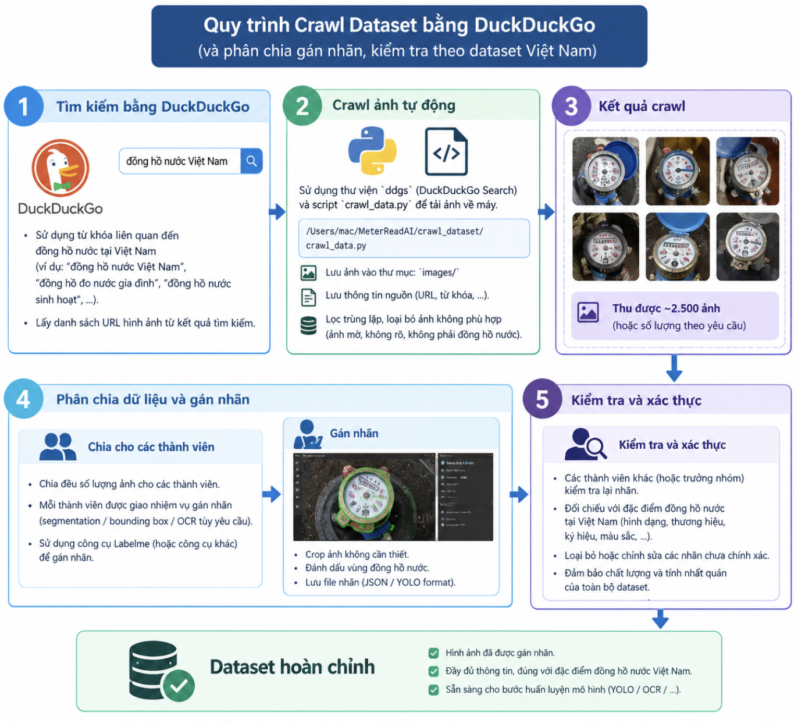
</p>
<p align="center">
  <em>Hình 3: Quy trình 5 bước thu thập, làm sạch và gán nhãn dataset đồng hồ nước Việt Nam</em>
</p>

---

## 3. 📱 Thiết kế Giao diện Người dùng (19 Màn hình Stitch UI/UX)

Toàn bộ hệ thống giao diện được thiết kế bám sát nguyên mẫu trên nền tảng **Google Stitch** gồm **19 màn hình trực quan** đáp ứng trọn vẹn cả 3 nhóm người dùng:

> 🔗 **Xem trực tiếp thiết kế tương tác trên Google Stitch**:  
> [https://stitch.withgoogle.com/projects/3346993615529581711](https://stitch.withgoogle.com/projects/3346993615529581711)

---

### 3.1. Phân hệ Xác thực & Hồ sơ (Authentication & Profile)

Gồm **2 màn hình** phục vụ xác thực an toàn, phân quyền người dùng và cấp phát mã truy cập:
- **Đăng nhập (Login)**: Giao diện đăng nhập đa vai trò (Khách hàng, Nhân viên, Quản trị viên) với JWT token an toàn.
- **Đăng ký (Register)**: Cổng tạo tài khoản cho khách hàng mới, liên kết mã danh bạ khách hàng (`customerCode`) và số hợp đồng cấp nước.

<p align="center">
  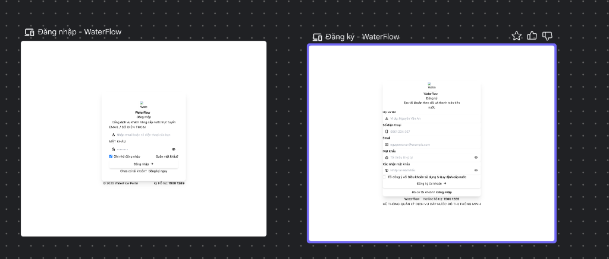
</p>
<p align="center">
  <em>Hình 4: Màn hình Đăng nhập (Login) và Đăng ký (Register) - Phân hệ Xác thực</em>
</p>

---

### 3.2. Cổng Thông tin Khách hàng (Customer Portal - WaterFlow)

Gồm **6 màn hình** thiết kế thân thiện, minh bạch tối đa chi phí tiêu thụ nước hàng tháng:
- **Dashboard Tổng quan Khách hàng**: Thống kê số tiền cần thanh toán trong kỳ, sản lượng $m^3$ so với tháng trước và đồ thị tiêu thụ nước.
- **Danh sách Hóa đơn (Invoices)**: Lịch sử hóa đơn qua các kỳ kèm trạng thái *Đã thanh toán* hoặc *Chưa thanh toán*.
- **Modal Minh chứng Chỉ số (Proof Image Modal)**: **Tính năng minh bạch cốt lõi** — khách hàng xem trực tiếp ảnh chụp đồng hồ tại hiện trường kèm ngày giờ ghi số, chỉ số AI đọc và chỉ số chốt của nhân viên.
- **Lịch sử Tiêu thụ (Consumption History)**: Biểu đồ cột phân tích lượng nước sử dụng qua các mốc thời gian, giúp phát hiện sớm rò rỉ sau đồng hồ.
- **Gửi Khiếu nại (Complaints)**: Khách hàng phản ánh trực tiếp khi nghi ngờ sai số kèm ảnh minh chứng từ phía gia đình.
- **Cổng Thanh toán (Payment Gateway)**: Thanh toán trực tuyến tích hợp VNPAY, Thẻ nội địa và Ví điện tử.

<p align="center">
  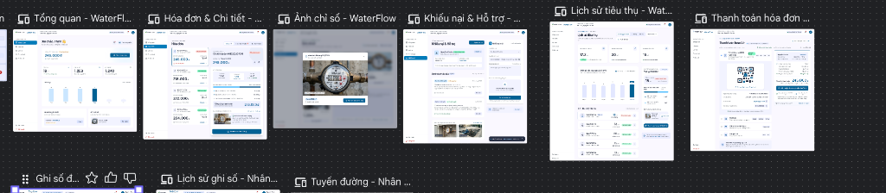
</p>
<p align="center">
  <em>Hình 5: Bộ 6 màn hình Cổng thông tin & Dịch vụ Khách hàng (WaterFlow Portal)</em>
</p>

---

### 3.3. Ứng dụng Di động Nhân viên Ghi số (Meter Reader Mobile App)

Gồm **3 màn hình** tối ưu hóa cho thao tác 1 tay trên thiết bị di động tại hiện trường:
- **Camera AI Ghi số Hiện trường**: Camera thời gian thực kèm khung lưới căn chỉnh mặt số, nút bấm chụp to bản, thanh đo độ sáng và tự động suy luận (inference) kết quả ngay sau khi chụp.
- **Lịch sử Đọc & Ghi nhận Bất thường**: Danh sách các điểm đo đã hoàn tất trong ca trực, cho phép gắn cờ cảnh báo bất thường (*Abnormality: bể mặt kính, kẹt kim, đọng nước, dấu hiệu gian lận*).
- **Tuyến Đọc Phân công**: Lộ trình di chuyển theo thứ tự địa chỉ nhà kèm bộ lọc đồng hồ *Đã ghi / Chưa ghi*.

<p align="center">
  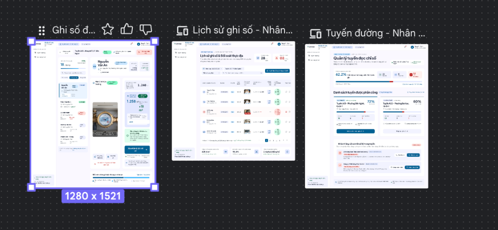
</p>
<p align="center">
  <em>Hình 6: Bộ 3 màn hình Ứng dụng Di động dành cho Nhân viên Ghi số hiện trường</em>
</p>

---

### 3.4. Hệ thống Quản trị & Điều hành Doanh nghiệp (Admin Portal)

Gồm **8 màn hình** dành cho khối vận hành và ban quản lý xí nghiệp cấp nước:
- **Tổng quan Điều hành (Dashboard)**: Theo dõi trực quan KPI tổng sản lượng bơm, tổng tiêu thụ, tỷ lệ thất thoát nước, tiến độ ghi số toàn thành phố và doanh thu theo ngày.
- **Quản lý Tuyến đọc (Routes)**: Thiết lập danh mục tuyến, khu vực và mã trạm cấp nước.
- **Phân công Nhân sự (Assignments)**: Điều phối ca trực và phân bổ danh sách khách hàng cần ghi số cho từng nhân viên.
- **Quản lý Nhân sự (Employees)**: Quản lý hồ sơ nhân viên, mã thẻ công tác và đánh giá hiệu suất hoàn thành tuyến đọc.
- **Quản lý Hóa đơn & Chốt kỳ (Invoices)**: Phê duyệt chỉ số, tự động tính tiền nước bậc thang và xuất hóa đơn điện tử hàng loạt.
- **Cấu hình Biểu giá Bậc thang (Tariff Settings)**: Tùy biến mức giá bậc thang sinh hoạt ($0-10 m^3$, $10-20 m^3$, $20-30 m^3$, $>30 m^3$), biểu giá kinh doanh/sản xuất, thuế GTGT (5%) và phí BVMT (10%).
- **Báo cáo Thống kê (Reports)**: Phân tích doanh thu, tỷ lệ thất thoát nước thương mại, biểu đồ công nợ khách hàng.
- **Xử lý Khiếu nại (Complaints Management)**: Tiếp nhận phiếu khiếu nại, chỉ định nhân viên kiểm tra lại hiện trường và lưu vết giải quyết.

<p align="center">
  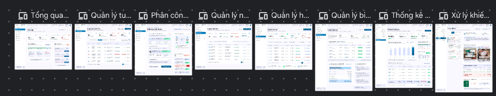
</p>
<p align="center">
  <em>Hình 7: Bộ 8 màn hình Hệ thống Quản trị & Điều hành Doanh nghiệp (Admin Portal)</em>
</p>

---

## 4. 📊 Tổng quan Dataset

Dự án tổng hợp và chuẩn hóa 3 tập dữ liệu đồng hồ nước uy tín trên thế giới và bộ dữ liệu thực tế tại Việt Nam:

| Dataset | Nguồn | Số lượng ảnh | Phân chia (Train / Val / Test) | Định dạng nhãn |
| :--- | :--- | :--- | :--- | :--- |
| **WaterMeters (D3)** | [Kaggle - Yandex Toloka](https://www.kaggle.com/datasets/tapakah68/yandextoloka-water-meters-dataset) | 1,244 | 995 / 124 / 125 | JPEG + Polygon masks (reading region) |
| **Word-Wheel (D2)** | [Dryad Repository](https://datadryad.org/dataset/doi:10.5061/dryad.7d7wm3860) | 46,097 *(gốc: 46,098)* | 29,436 / 3,270 / 13,391 | PNG → JPEG + Segmentation masks |
| **OCR Water Meter (D4)** | [Roboflow Universe](https://universe.roboflow.com/traffic-zcg6o/ocr-water-meters/dataset/2) | 10,598 | 9,273 / 880 / 445 | JPEG + YOLO polygon labels (digits) |
| **Merge-Dataset (D1)** | *Kết hợp D2 + D3 + D4* | **57,939** | **39,704 / 4,274 / 13,961** | YOLO polygon format (16,247 test instances) |

### 4.1. Bộ Dữ liệu Nhận diện Chữ số Đồng hồ Nước (OCR / Digit Datasets)
Phục vụ bài toán cắt lọc vùng mặt số (`reading_region`) và nhận diện chuỗi chữ số bánh răng chuẩn kích thước `(H=60, W=200)`:

| Dataset | Mô tả & Nguồn gốc | Số lượng ảnh | Phân chia (Train / Val / Test) | Link Google Drive |
| :--- | :--- | :--- | :--- | :--- |
| **`data_1` (DuckDuckGo)** | Ảnh thu thập thực tế tại Việt Nam qua DuckDuckGo và gán nhãn nhận diện chữ số | 239 | 191 / 23 / 25 | [Google Drive - DuckDuckGo Dataset](https://drive.google.com/drive/folders/1_X-YEpZXvZ0kf4587wA0HyydjVwBagxR?usp=sharing) |
| **`data_2` (Base Datasets)** | Dữ liệu gán nhãn nhận diện chữ số từ các tập dataset ban đầu (`ocr_water_meter` & `water_meters`) | 1,498 | 473 / 780 / 245 | [Google Drive - Base Datasets OCR Labels](https://drive.google.com/drive/folders/1NOSI8uuBCsmmhvh0fjHcnblbG5Q43TGB?usp=sharing) |
| **`merge_recognition` (Sau Aug)** | Tập hợp nhất & Data Augmentation, gán nhãn chữ số động từ 4 đến 8 chữ số | **18,523** | **13,612 / 2,242 / 2,669** | *Huấn luyện OCR tổng quát* |

---

## 5. 🔍 Khám phá & Đánh giá Dữ liệu (EDA)

Chi tiết phân tích dữ liệu được lưu trữ tại thư mục [`eda/`](eda/):

### 5.1. WaterMeters Dataset (D3)
- **Notebook**: [`eda/check_watermeters.ipynb`](eda/check_watermeters.ipynb)
- **Đặc trưng**: 1,244 ảnh, tỷ lệ mask trung bình chiếm **2.32%** diện tích khung hình. Vị trí phân bổ tập trung vào tâm đồng hồ, không có ảnh trùng lặp MD5.

<p align="center">
  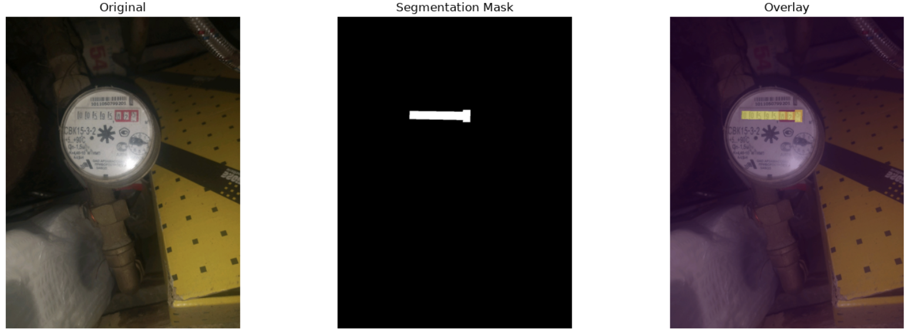
  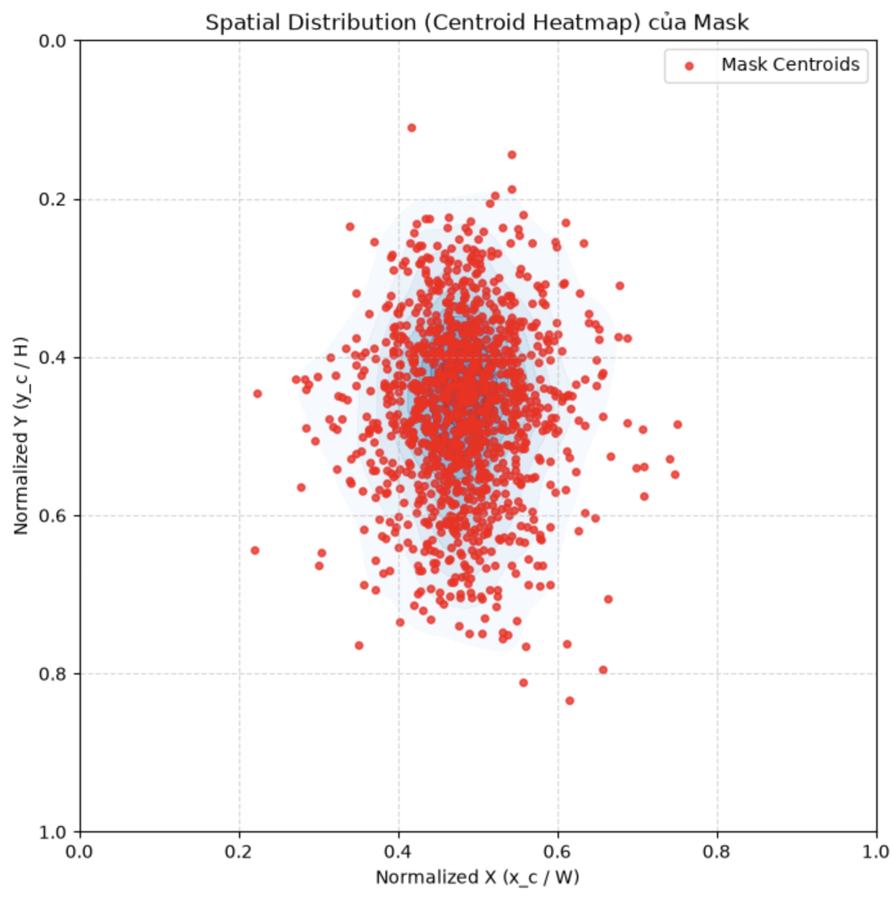
</p>

---

### 5.2. Word-Wheel Water Meter Dataset (D2)
- **Notebooks**: [`eda/check_word_wheel_water_meter_train_dataset.ipynb`](eda/check_word_wheel_water_meter_train_dataset.ipynb), [`eda/check_word_wheel_water_meter_test_dataset.ipynb`](eda/check_word_wheel_water_meter_test_dataset.ipynb)
- **Đặc trưng**: Tỷ lệ mask trung bình **3.78%** (Train) và **3.37%** (Test). Phát hiện và loại bỏ cặp ảnh trùng lặp (`train1873.png` & `train1888.png`).

<p align="center">
  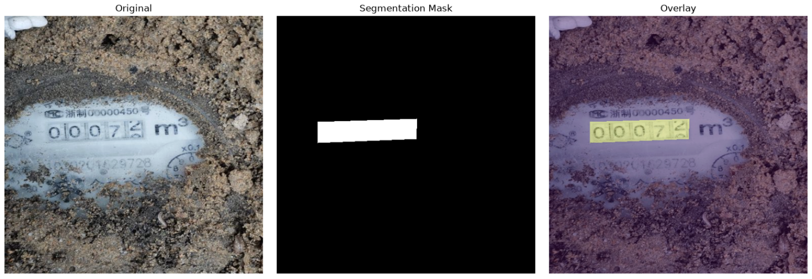
  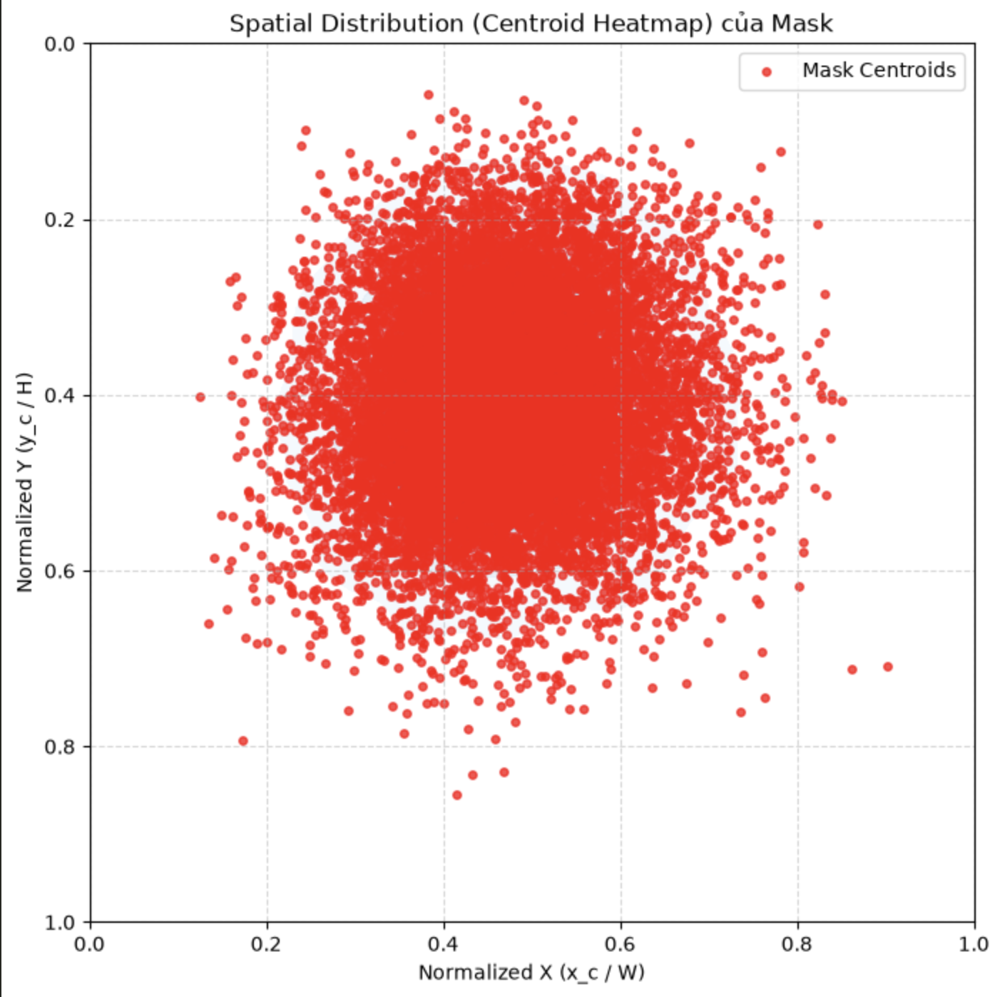
</p>

---

### 5.3. OCR Water Meter Dataset (D4)
- **Notebooks**: [`eda/check_ocr_water_meter_train.ipynb`](eda/check_ocr_water_meter_train.ipynb), [`eda/check_ocr_water_meter_valid.ipynb`](eda/check_ocr_water_meter_valid.ipynb), [`eda/check_ocr_water_meter_test.ipynb`](eda/check_ocr_water_meter_test.ipynb)
- **Đặc trưng**: Tỷ lệ polygon mask trung bình **5.78%** (Train), **5.77%** (Val), **5.65%** (Test) với hơn 65,178 polygons chữ số nhỏ nằm san sát nhau trên bánh răng cơ học.

<p align="center">
  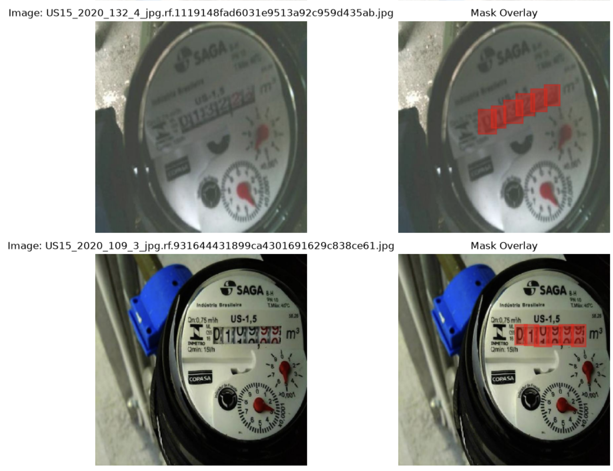
  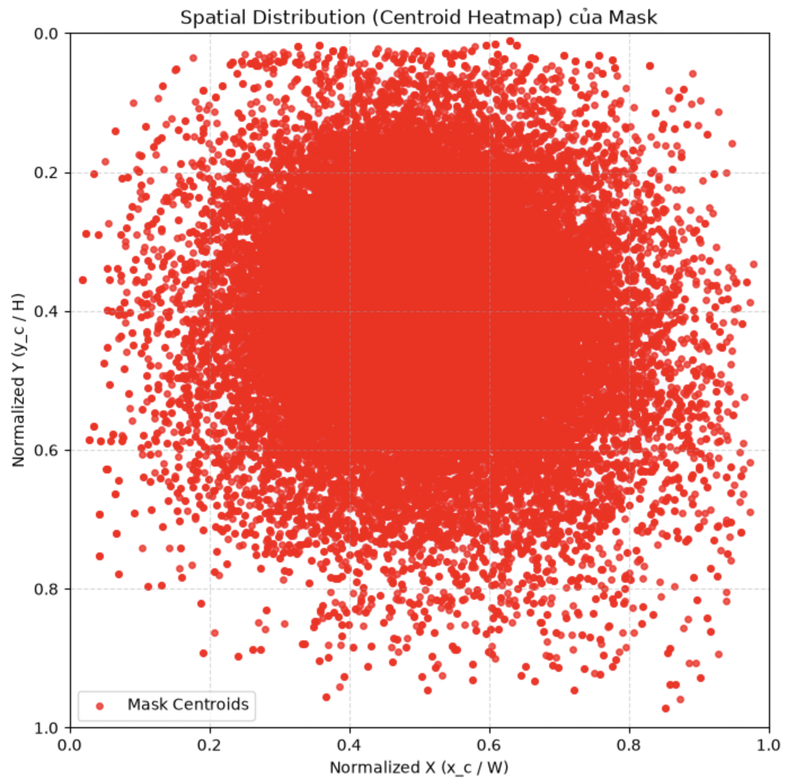
</p>

---

## 6. 🛠️ Tiền xử lý & Trực quan hóa Dữ liệu

### 6.1. Pipeline Tiền xử lý (Preprocessing)
Toàn bộ mã nguồn nằm tại thư mục [`preprocessing_data/`](preprocessing_data/):
1. **Chuẩn hóa nhãn Polygon**: Chuyển đổi định dạng mask binary và JSON sang chuẩn tọa độ đa giác chuẩn hóa của YOLO: `class_id x1 y1 x2 y2 ... xn yn` ($x, y \in [0, 1]$).
2. **Phân chia dữ liệu chống rò rỉ (No Data Leakage)**: Tách riêng rẽ tuyệt đối 80% Train, 10% Validation và 10% Test dựa trên ID ảnh gốc.
3. **Cấu trúc thư mục chuẩn Ultralytics**:
   ```text
   dataset/
   ├── images/ (train / val / test)
   └── labels/ (train / val / test)
   ```

### 6.2. Trực quan hóa Dữ liệu Gán nhãn

<p align="center">
  <b>WaterMeters Dataset (D3)</b><br/>
  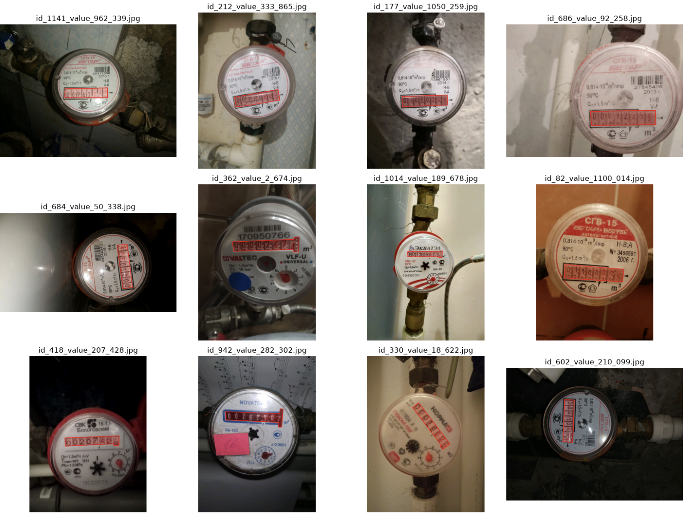
</p>

<p align="center">
  <b>Word-Wheel Water Meter Dataset (D2)</b><br/>
  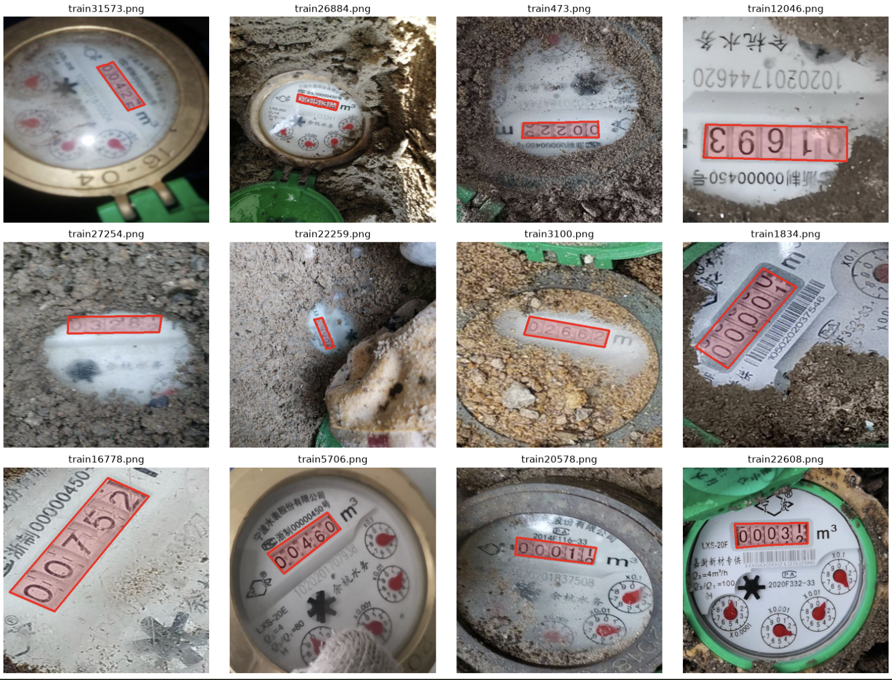
</p>

<p align="center">
  <b>OCR Water Meter Dataset (D4)</b><br/>
  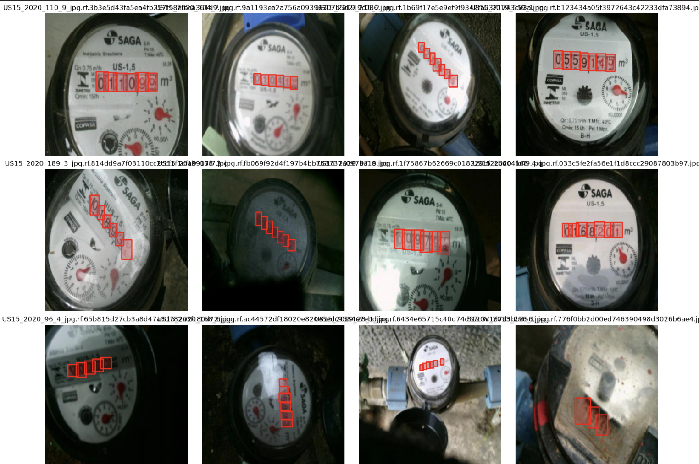
</p>

---

## 7. 🏆 Báo cáo Kết quả Đánh giá Mô hình Cơ sở (Baseline Models)

Các mô hình Instance Segmentation cơ sở được huấn luyện và đánh giá trên phần cứng **GPU NVIDIA Tesla T4** với 4 kịch bản dữ liệu:
- **D1 (merge-dataset)**: 13,961 ảnh test, 16,247 instances
- **D2 (word-wheel-water-meter)**: 13,391 ảnh test
- **D3 (water-meters)**: 125 ảnh test
- **D4 (ocr-water-meter)**: 445 ảnh test, 2,731 instances

### 7.1. Bảng so sánh hiệu năng các mô hình Phân đoạn Baseline (Instance Segmentation)

| Phụ trách | Model | Dataset | Layers | Params | GFLOPs | Box mAP50 | Box mAP50-95 | Mask mAP50 | Mask mAP50-95 | F1-Score | FPS (T4) |
| :--- | :--- | :--- | :---: | :---: | :---: | :---: | :---: | :---: | :---: | :---: | :---: |
| **Gia Thịnh** | **YOLO26n-seg** | **D1 (Merge)** | 136 | 2.69M | 9.1 | **0.994** | **0.780** | **0.983** | **0.686** | **0.9944** | **139.85** |
| | | D2 | 139 | 2.69M | 9.1 | 0.995 | 0.816 | 0.995 | 0.743 | 0.9975 | 143.47 |
| | | D3 | 139 | 2.69M | 9.1 | 0.988 | 0.940 | 0.988 | 0.869 | 0.9616 | 77.15 |
| | | D4 | 139 | 2.69M | 9.1 | 0.984 | 0.576 | 0.842 | 0.316 | 0.9576 | 115.16 |
| **Quang Hưng** | **YOLO12n-seg** | **D1 (Merge)** | 172 | 2.81M | 10.6 | **0.995** | **0.778** | **0.983** | **0.684** | **0.9936** | **106.50** |
| | | D2 | 172 | 2.81M | 10.6 | 0.995 | 0.812 | 0.995 | 0.741 | 0.9995 | 104.56 |
| | | D3 | 172 | 2.81M | 10.6 | 0.995 | 0.847 | 0.995 | 0.834 | 0.9944 | 63.84 |
| | | D4 | 172 | 2.81M | 10.6 | 0.985 | 0.570 | 0.833 | 0.306 | 0.9693 | 84.60 |
| **Bảo Duy** | **YOLO11n-seg** | **D1 (Merge)** | 114 | 2.83M | 9.6 | **0.995** | **0.784** | **0.983** | **0.690** | **0.9939** | **144.25** |
| | | D2 | 114 | 2.83M | 9.6 | 0.995 | 0.813 | 0.995 | 0.743 | 0.9997 | 143.40 |
| | | D3 | 114 | 2.83M | 9.6 | 0.995 | 0.947 | 0.995 | 0.887 | 0.9943 | 75.63 |
| | | D4 | 114 | 2.83M | 9.6 | 0.985 | 0.578 | 0.827 | 0.311 | 0.9699 | 108.67 |
| **Nguyên Khánh**| **YOLOv8n-seg** | **D1 (Merge)** | 86 | 3.26M | 11.3 | **0.995** | **0.781** | **0.983** | **0.684** | **0.9942** | **144.21** |
| | | D2 | 86 | 3.26M | 11.3 | 0.995 | 0.812 | 0.995 | 0.741 | 0.9997 | 145.58 |
| | | D3 | 86 | 3.26M | 11.3 | 0.995 | 0.923 | 0.995 | 0.879 | 0.9956 | 88.61 |
| | | D4 | 86 | 3.26M | 11.3 | 0.984 | 0.566 | 0.835 | 0.314 | 0.9691 | 104.62 |
| **Công Hùng** | **YOLOE-26n-seg**| **D1 (Merge)** | 162 | 4.94M | 9.9 | 0.582 | 0.387 | 0.594 | 0.381 | 0.5836 | 87.06 |
| | | D2 | 162 | 4.94M | 9.9 | 0.729 | 0.421 | 0.754 | 0.465 | 0.6902 | 113.53 |
| | | D3 | 162 | 4.94M | 9.9 | 0.758 | 0.553 | 0.778 | 0.578 | 0.6814 | 82.72 |
| | | D4 | 164 | 4.90M | 9.7 | 0.031 | 0.013 | 0.023 | 0.007 | 0.0868 | 115.00 |
| **Đăng Khoa** | **YOLOE-11s-seg**| **D1 (Merge)** | 139 | 13.69M | 34.0 | 0.401 | 0.282 | 0.392 | 0.265 | 0.4195 | 53.49 |
| | | D2 | 139 | 13.69M | 34.0 | 0.645 | 0.469 | 0.640 | 0.422 | 0.6298 | 61.17 |
| | | D3 | 139 | 13.69M | 34.0 | 0.798 | 0.533 | 0.806 | 0.515 | 0.8212 | 55.56 |
| | | D4 | 139 | 13.69M | 34.0 | 0.430 | 0.218 | 0.328 | 0.115 | 0.4575 | 44.60 |
| **Quốc Anh** | **YOLOE-v8s-seg**| **D1 (Merge)** | 111 | 15.41M | 41.0 | 0.296 | 0.230 | 0.293 | 0.210 | 0.4068 | 57.44 |
| | | D2 | 111 | 15.41M | 41.0 | 0.449 | 0.318 | 0.459 | 0.310 | 0.4875 | 60.53 |
| | | D3 | 111 | 15.41M | 41.0 | 0.730 | 0.674 | 0.730 | 0.651 | 0.7272 | 43.07 |
| | | D4 | 111 | 15.41M | 41.0 | 0.116 | 0.059 | 0.091 | 0.031 | 0.2279 | 52.25 |

---

### 7.2. Nhận diện Chuỗi Chữ số OCR Baseline Sau Data Augmentation (CRNN vs. Tesseract)

#### 🎯 Bối cảnh Thực nghiệm & Động lực Data Augmentation:
- **Hạn chế của bộ dữ liệu ban đầu:** Trong giai đoạn thử nghiệm đầu tiên, tập dữ liệu chỉ chứa các nhãn có độ dài cố định từ 5 đến 6 chữ số. Do không gian nhãn đơn điệu, mô hình dễ đạt chỉ số đánh giá rất cao trên tập kiểm thử hẹp nhưng thực chất bị phụ thuộc vào độ dài cố định (*length bias*) và kém khả năng tổng quát hóa khi gặp mặt đồng hồ có cấu hình khác ngoài hiện trường.
- **Mở rộng dữ liệu & Data Augmentation:** Để mô hình học tổng quát hơn (*generalization*), nhóm đã tự thu thập ảnh đồng hồ nước thực tế tại Việt Nam, cắt lọc chính xác phần số và mở rộng tập gán nhãn với nhiều độ dài biến thiên linh hoạt từ **4 đến 8 chữ số** (`merge_recognition`). Đồng thời, các kỹ thuật tăng cường dữ liệu thực tế (biến dạng hình học, xoay góc nghiêng, nhiễu sáng, mờ bẩn bề mặt kính) được áp dụng để mô phỏng chính xác điều kiện làm việc của nhân viên ghi số.
- **Tập kiểm thử độc lập sau Augmentation (`merge_recognition`):** Gồm **2,669 mẫu ảnh test** độc lập với nhãn đa dạng 4–8 chữ số. Cả 2 mô hình nhận diện ký tự cơ sở gồm **CRNN** (`models_baseline/crnn_after_aug`) và **Tesseract OCR fine-tuned LSTM** (`models_baseline/tesseract_after_aug`) đều được huấn luyện 200 epochs với cùng cấu hình siêu tham số và đánh giá theo chuẩn Levenshtein metrics.

#### 📊 Bảng so sánh chỉ số OCR Baseline sau Data Augmentation (Tập Test: 2,669 mẫu):

| Chỉ số Đánh giá | CRNN (`crnn_after_aug`) | Tesseract OCR (`tesseract_after_aug`) | Đánh giá & Chênh lệch |
| :--- | :---: | :---: | :--- |
| **Kiến trúc mô hình** | CNN + BiLSTM + CTC Loss | Tesseract 5 LSTM Engine (Fine-tuned 200 Epochs, PSM 7) | CRNN thiết kế chuyên biệt cho nhận diện chữ số thực tế |
| **Số mẫu kiểm thử (Test Samples)** | **2,669** | **2,669** | Tập test thực tế nhãn đa dạng 4–8 chữ số |
| **Sequence Accuracy** *(Toàn chuỗi đúng tuyệt đối)* | **87.94%** (0.8794) | **3.18%** (0.0318) | **CRNN vượt trội +84.76%** |
| **Character Accuracy** *(Chính xác từng ký tự)* | **95.50%** (0.9550) | **19.89%** (0.1989) | **CRNN vượt trội +75.61%** |
| **Precision** | **0.9623** (96.23%) | **0.6927** (69.27%) | CRNN nhận diện chuẩn xác, ít nhầm lẫn |
| **Recall** | **0.9550** (95.50%) | **0.1989** (19.89%) | Tesseract bỏ sót nhiều ký tự do khoảng cách hẹp |
| **F1-Score** | **0.9586** (95.86%) | **0.3090** (30.90%) | **CRNN cao hơn gấp 3.1 lần** |
| **CER** *(Character Error Rate - càng thấp càng tốt)* | **4.77%** (0.0477) | **82.80%** (0.8280) | **CRNN giảm lỗi ký tự hơn 17.3 lần** |
| **Tổng Edit Distance (Levenshtein)** | **682** | **11,838** | CRNN có độ lệch ký tự tổng thể cực thấp |
| **Thời gian Test / Tốc độ suy luận** | ~2m 26s (**~54.7 ms/ảnh**) | ~12m 57s (**~291.1 ms/ảnh**) | **CRNN nhanh hơn ~5.3 lần** |

#### 💡 Nhận định & Kết luận:
1. **Khả năng tổng quát hóa của CRNN:** Khi dữ liệu được mở rộng nhãn biến thiên từ 4 đến 8 chữ số và chịu tác động của augmentation, CRNN vẫn duy trì độ chính xác ký tự ấn tượng **95.50%** và F1-score **95.86%**, với tỷ lệ lỗi CER chỉ **4.77%**. Điều này chứng minh mô hình đã học được đặc trưng ngữ cảnh chuỗi thay vì ghi nhớ độ dài cố định.
2. **Hạn chế của Tesseract:** Dù được fine-tune LSTM 200 epochs theo đúng hướng dẫn chuẩn `tesstrain`, Tesseract chỉ đạt Sequence Accuracy **3.18%** và CER lên đến **82.80%**. Tesseract truyền thống được tối ưu cho tài liệu văn bản in phẳng, không thể thích ứng với phông chữ cơ học dập nổi trên bánh răng, viền số sát nhau và hiện tượng lóa sáng/đọng nước trên mặt đồng hồ.
3. **Quyết định triển khai:** CRNN sau augmentation được tích hợp chính thức vào module AI Engine (`backend/app/services/ai_service.py`), kết hợp cùng mô hình phân đoạn YOLO11-seg để phục vụ tác nghiệp hiện trường thời gian thực.

#### 📸 Hình ảnh Thử nghiệm Thực tế trên Website (Live Inference Demo):
Hệ thống MeterReadAI & WaterFlow sau khi tích hợp toàn diện mô hình phân đoạn **YOLO11-seg** (`best.onnx`) và mô hình nhận diện chuỗi ký tự **CRNN sau Augmentation** (`best_model.pth`):
- **Khả năng tổng quát hóa với đa dạng cấu hình mặt số:** Nhận diện chuẩn xác từ đồng hồ nước sinh hoạt **5 chữ số**, **7 chữ số** đến các loại đồng hồ công nghiệp lớn **8 chữ số**.
- **Tuân thủ quy chuẩn nghiệp vụ & Bảo toàn số 0 ở đầu:** Chuỗi số đọc được bảo toàn nguyên vẹn định dạng ký tự chuỗi (`"02728"` $\to$ $2.728 \text{ m}^3$, `"0010942"` $\to$ $10.942 \text{ m}^3$, `"00322032"` $\to$ $322.032 \text{ m}^3$).
- **Tính toán lũy tiến hóa đơn tự động:** Tự động đối soát điều kiện $I_{mới} \ge I_{cũ}$, tính lượng tiêu thụ tức thời và áp biểu giá bậc thang sinh hoạt đa tầng (Bậc 1, Bậc 2, Bậc 3 kèm VAT 5% và phí BVMT 10%) với độ chính xác tuyệt đối.
- **Trải nghiệm thị giác tối ưu (Anti-Overlap HUD):** Vùng mặt số được bao quanh bằng đường viền đa giác (Polygon Masking) chính xác theo góc nghiêng thực tế; nhãn nhận diện AI được đưa lên góc hiển thị HUD thông minh **hoàn toàn không che đè lên vùng chữ số**, giúp nhân viên dễ dàng kiểm tra đối chứng tại hiện trường.

<p align="center">
  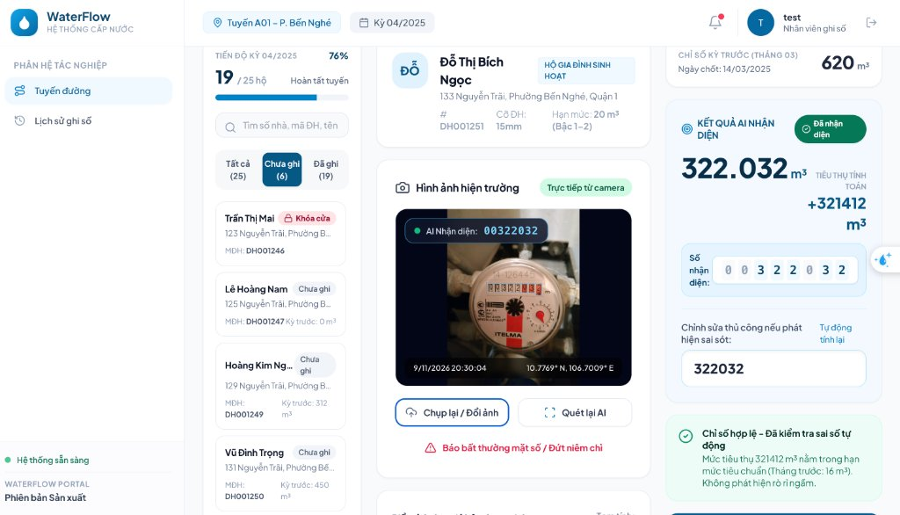
  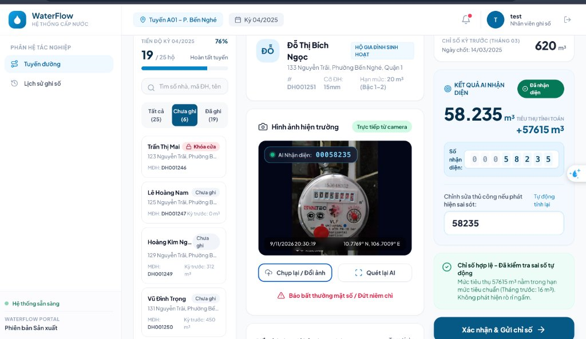
</p>
<p align="center">
  <em>Hình 7.1: Giao diện thử nghiệm chạy thật trên website với mô hình YOLO11-seg và CRNN sau Augmentation nhận diện đồng hồ nước 8 chữ số</em>
</p>

<p align="center">
  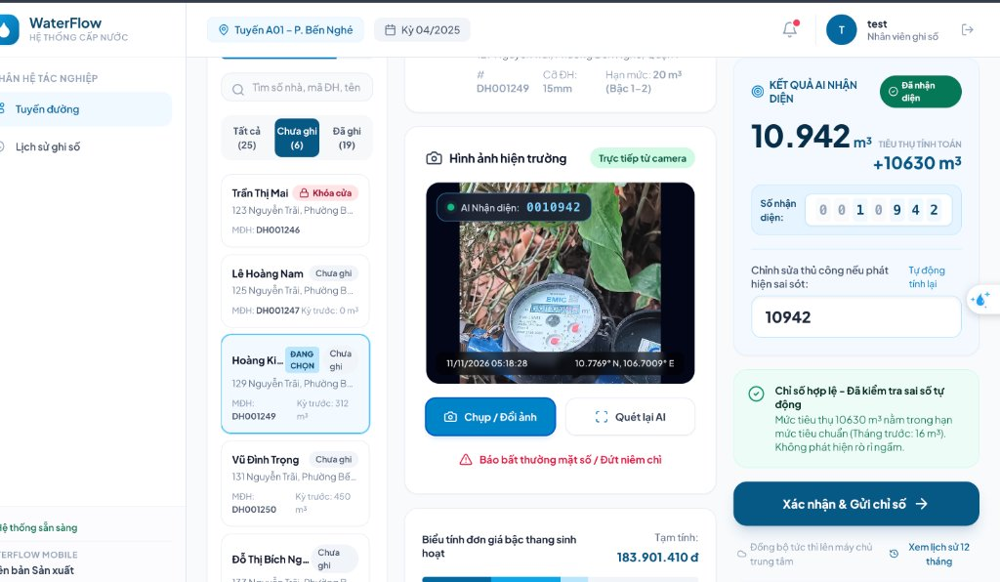
  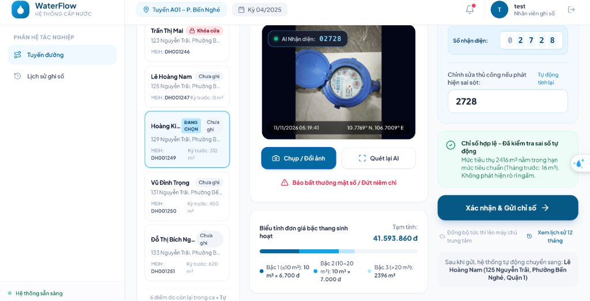
</p>
<p align="center">
  <em>Hình 7.2: Thử nghiệm thực tế với đồng hồ 7 chữ số (0010942 - tạm tính 183.901.410 đ) và 5 chữ số (02728 - tạm tính 41.593.860 đ) kèm phân bổ bậc thang chi tiết</em>
</p>

---

## 8. 🔬 Phân tích Lỗi Chuyên sâu (Error Analysis) & Động lực Cải tiến

Nhóm đã sử dụng ma trận phân tích lỗi dự đoán (Prediction Error Matrix) chia lỗi thành 5 nhóm thành phần:
- **Loc (Localization Error)**: Phát hiện đúng đối tượng nhưng sai lệch ranh giới tọa độ ($IoU < 0.5$).
- **Bkg (Background Error)**: Dự đoán nhầm vùng nền (vỏ kim loại, viền cao su, mặt số đồng hồ) thành chữ số hoặc ngược lại.
- **Miss (False Negative)**: Bỏ sót hoàn toàn đối tượng ground truth.
- **Cls (Classification Error)**: Nhầm lẫn giữa các ký tự chữ số tương đồng (ví dụ: $0$ và $8$, $3$ và $8$, $1$ và $7$).
- **Dupe (Duplicate Detection)**: Dự đoán trùng lặp cùng một chữ số do thuật toán NMS chưa lọc triệt để.

<p align="center">
  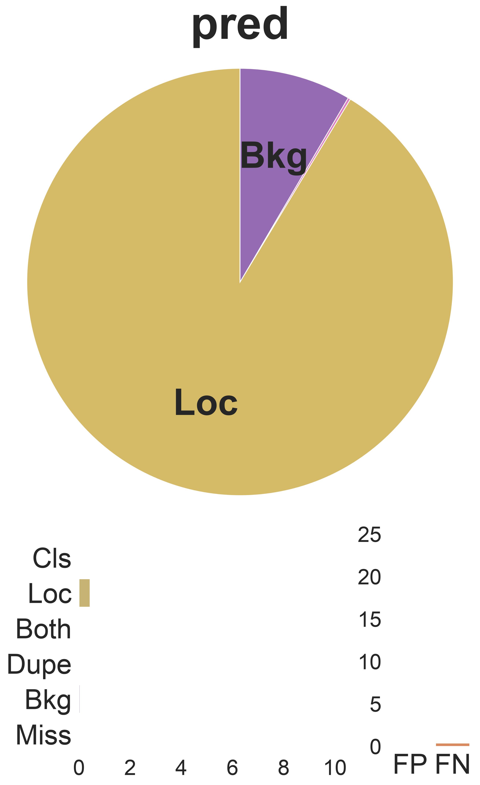
  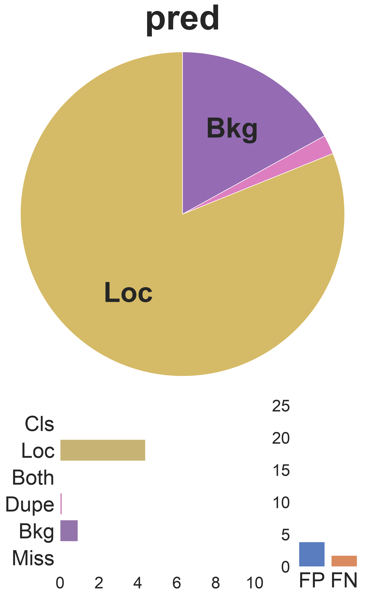
</p>
<p align="center">
  <em>Hình 8: Phân tích lỗi trên <b>Merge Dataset (D1)</b> (trái) và <b>OCR Water Meter Dataset (D4)</b> (phải)</em>
</p>

<p align="center">
  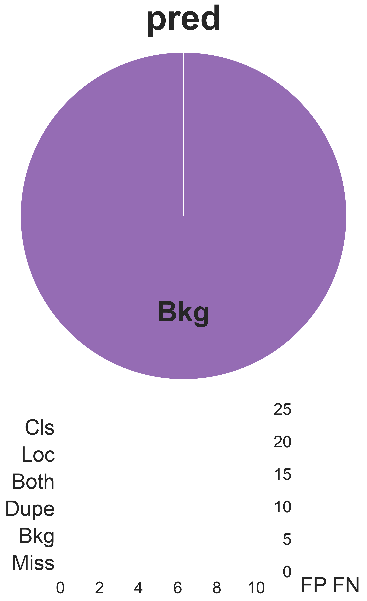
  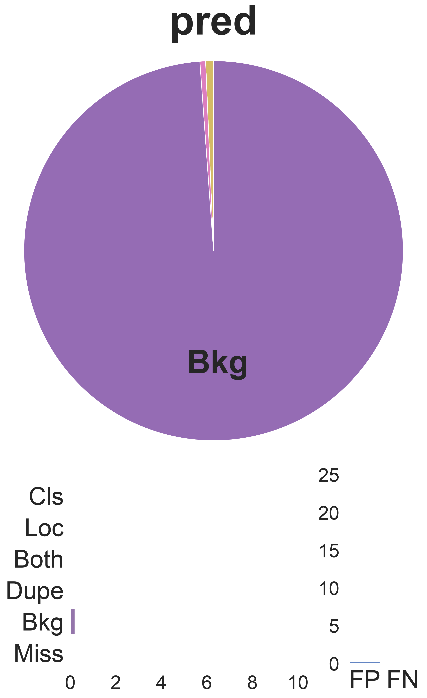
</p>
<p align="center">
  <em>Hình 9: Phân tích lỗi trên <b>Water Meters Dataset (D3)</b> (trái) và <b>Word-Wheel Dataset (D2)</b> (phải)</em>
</p>

### 💡 Phát hiện cốt lõi từ phân tích lỗi:
1. **Trên Dataset OCR Water Meter (D4)**:
   - **Lỗi Định vị (Loc) và Bỏ sót (Miss/FN)** chiếm tỷ trọng vượt trội. Các chữ số trên mặt đồng hồ có kích thước cực kỳ nhỏ (*micro-scale objects*), xếp thành một hàng ngang san sát nhau.
   - Khi góc chụp bị nghiêng hoặc mặt kính bị chói lóa, các tầng tích chập thông thường dễ làm nhòe thông tin vị trí không gian giữa các chữ số liền kề.
2. **Hạn chế của các cơ chế Attention truyền thống**:
   - Các cơ chế chú ý kênh truyền thống như **Squeeze-and-Excitation (SE)** nén toàn bộ không gian 2D thành một vector $1 \times 1 \times C$, vô tình làm **mất hoàn toàn tọa độ vị trí không gian** (spatial position).
   - Cơ chế Spatial Attention truyền thống (như trong CBAM) chỉ tính toán vùng cục bộ mà không nắm bắt được mối tương quan tầm xa dọc theo hàng chữ số ngang.
3. **Giải pháp đột phá**:
   - Cần một kiến trúc trích xuất đặc trưng có khả năng ánh xạ không gian vô hạn chiều tại tầng P3 (nguồn đặc trưng số nhỏ) với chi phí tính toán cực nhẹ (**C3k2_Star - StarNet CVPR 2024**), kết hợp với các hàm mất mát bounding box thích ứng hình học dẹp ngang (**Inner-CIoU, Inner-SIoU, Asymmetric Inner-CIoU**).

---

## 9. 🚀 Kiến trúc Mô hình YOLO11 & Các Giải pháp Cải tiến (Enhanced Models)

### 9.1. Tổng quan Kiến trúc YOLOv11

**YOLOv11** là thế hệ mô hình thị giác mới nhất của Ultralytics với những cải tiến vượt bậc về trích xuất đặc trưng và tối ưu hóa số lượng tham số:

<p align="center">
  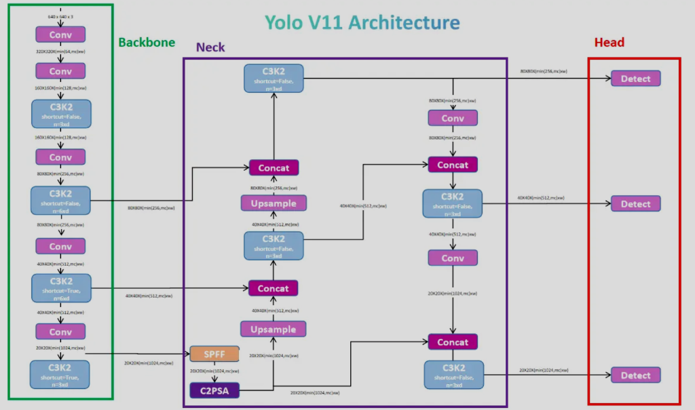
</p>
<p align="center">
  <em>Hình 10: Sơ đồ chi tiết Kiến trúc Mô hình YOLOv11 (Backbone, Neck và Decoupled Head)</em>
</p>

Kiến trúc gồm 3 thành phần chính:
1. **Backbone (Trích xuất đặc trưng)**:
   - Các khối `Conv` giảm chiều không gian từ $640 \times 640$ xuống các mức tỷ lệ $P1/2, P2/4, P3/8, P4/16, P5/32$.
   - **`C3k2` (Cross-Stage Partial with 2 Convolutions & kernel 3)**: Phiên bản tối ưu của khối C2f, cho phép kích hoạt cấu hình kernel linh hoạt để thu hẹp số lượng phép tính FLOPs nhưng gia tăng gradient flow.
   - **`SPFF` (Spatial Pyramid Pooling - Fast)**: Mở rộng trường tiếp nhận (receptive field) đa tỷ lệ ($5 \times 5, 9 \times 9, 13 \times 13$).
   - **`C2PSA` (Cross-Stage Partial with Pointwise Spatial Attention)**: Bổ sung cơ chế chú ý không gian điểm ở tầng đặc trưng sâu nhất $P5$ ($20 \times 20$), tăng cường khả năng phân biệt đối tượng với nền phức tạp.
2. **Neck (Đa tỷ lệ đặc trưng - FPN + PAN)**:
   - Kết hợp đường truyền đặc trưng ngữ nghĩa từ trên xuống (Top-down pathway qua `Upsample` và `Concat`) và đường truyền chi tiết không gian từ dưới lên (Bottom-up pathway qua `Conv` stride 2 và `Concat`).
   - Sử dụng các khối `C3k2` để tinh chỉnh đặc trưng ở 3 mức phân giải: $P3$ (vật thể nhỏ), $P4$ (vật thể trung bình), $P5$ (vật thể lớn).
3. **Head (Đầu ra dự đoán)**:
   - Thiết kế Decoupled Head không neo (Anchor-free) phân tách độc lập nhánh phân loại (Classification), nhánh hồi quy hộp bao (Bounding Box Regression) và nhánh phân đoạn mặt nạ (Mask Proto & Mask Coefficients).

---

### 9.2. Lý do Nhóm Lựa chọn YOLO11 làm Mô hình Chủ đạo

Sau khi đối chiếu kết quả thực nghiệm giữa các họ mô hình:
1. **So với YOLOv8**: YOLO11 có số tham số ít hơn (**2.83M** so với 3.26M, giảm ~13.2%) và FLOPs thấp hơn (**9.6** so với 11.3 GFLOPs), nhưng đạt độ chính xác Box mAP50-95 trên tập D1 cao hơn (**0.784** so với 0.781). Khối `C3k2` và `C2PSA` giúp mô hình hội tụ nhanh và mượt hơn.
2. **So với họ YOLOE (YOLOE-26n, YOLOE-11s, YOLOE-v8s)**: Các kiến trúc YOLOE dù có kích thước tham số lớn (4.94M - 15.41M) nhưng bị suy giảm nghiêm trọng trên các tập dữ liệu ký tự nhỏ như D4 (chỉ đạt 0.031 - 0.430 Box mAP50) do hiện tượng khó hội tụ ở các box micro-scale. Ngược lại, YOLO11 thể hiện độ bền bỉ vượt trội trên cả 4 kịch bản dữ liệu.
3. **Khả năng triển khai Edge/Mobile thực tế**: YOLO11n-seg đạt tốc độ suy luận **108 - 144 FPS** trên GPU Tesla T4 (độ trễ chỉ ~6.7 - 7.3 ms/ảnh), hoàn toàn tương thích để chạy mượt mà trên các thiết bị di động cầm tay của nhân viên ghi số nước ngoài hiện trường.

---

### 9.3. Các Phương pháp Cải tiến Đột phá (C3k2_Star, Inner-CIoU, Inner-SIoU, Asymmetric Inner-CIoU)

Nhóm đã nghiên cứu và triển khai **4 giải pháp cải tiến chuyên sâu** nhắm thẳng vào các bài toán hóc búa của đồng hồ nước (hộp số chữ nhật dẹp, chữ số micro-scale, xoay góc nghiêng và nhiễu phản xạ):

#### 1. C3k2_Star (StarNet CVPR 2024) — Cải tiến Kiến trúc Backbone tại P3
- **Nguyên lý**: Kế thừa khối StarBlock từ công trình *"Rewrite the Stars"* (CVPR 2024), thay thế các khối Bottleneck chuẩn trong C3k2 tại tầng trích xuất P3/8 (nơi bắt đầu các đặc trưng ký tự và viền số). Khối áp dụng tích chập sâu Depthwise $7 \times 7$ và **phép nhân sao (Star Operation)** giữa hai nhánh chiếu $f_1, f_2$:
  $$\text{StarBlock}(x) = \text{DWConv}_2\Big(g\big(\text{ReLU6}(f_1(x)) \odot f_2(x)\big)\Big) + x$$
- **Tác dụng**: Phép nhân theo từng phần tử (element-wise multiplication) ánh xạ đặc trưng sang không gian số chiều vô hạn (implicit high-dimensional space) tương tự Self-Attention nhưng độ phức tạp tuyến tính $\mathcal{O}(N)$ thay vì $\mathcal{O}(N^2)$. Giúp bám sát đường viền đa giác cực mịn (Mask mAP50-95 tăng từ 88.7% lên **89.5%**), đồng thời bứt phá tốc độ suy luận từ 75.6 lên **118.7 FPS (+56.9% throughput)**.

#### 2. Inner-CIoU Loss — Đột phá Hàm Mất mát với Hộp Phụ trợ
- **Nguyên lý**: Đưa vào hộp phụ trợ (Auxiliary Bounding Box) có tỷ lệ $\text{ratio} < 1.0$ đồng tâm với hộp gốc:
  $$b_l^{inner} = x_c - \frac{w \times \text{ratio}}{2}, \quad b_r^{inner} = x_c + \frac{w \times \text{ratio}}{2}$$
- **Tác dụng**: Khuếch đại gradient hồi quy cho các bounding box nhỏ, giúp mô hình hội tụ nhanh hơn và ôm sát ranh giới hộp số.

#### 3. Inner-SIoU Loss — Kết hợp Inner Box và Phạt Góc Định hướng
- **Nguyên lý**: Tích hợp cơ chế Auxiliary Box của Inner-IoU vào hàm phạt góc xoay và khoảng cách của SIoU.
- **Tác dụng**: Cực kỳ hữu hiệu khi đối phó với ảnh chụp đồng hồ bị xoay góc nghiêng, góc chéo từ camera điện thoại.

#### 4. Asymmetric Inner-CIoU Loss — Tùy biến Co giãn Bất đối xứng
- **Nguyên lý**: Thay vì dùng cùng một hệ số $\text{ratio}$ cho cả 2 chiều, phương pháp áp dụng hệ số bất đối xứng $\text{ratio}_w \ne \text{ratio}_h$ (ví dụ: $\text{ratio}_w = 0.8$, $\text{ratio}_h = 1.0$).
- **Tác dụng**: Phản ánh chính xác đặc thù hình học của vùng đọc số đồng hồ nước tại Việt Nam ($W \gg H$), ngăn ngừa hiện tượng bão hòa sớm của cạnh dài. Đặc biệt không làm tăng tham số hay độ trễ khi suy luận (**FPS đạt tới 128 FPS**).

---

### 9.4. Bảng So sánh Hiệu năng Toàn diện: Baseline vs. Các Mô hình Cải tiến

Kết quả đánh giá độc lập trên tập kiểm thử (Test Split) với GPU **NVIDIA Tesla T4** trên cả 4 kịch bản dữ liệu:

#### 1. Trên tập OCR Water Meter (D4 — 445 ảnh test, 2,731 instances ký tự chữ số nhỏ):
| Mô hình | Layers | Params | GFLOPs | Box mAP50 | Box mAP50-95 | Mask mAP50 | Mask mAP50-95 | F1-Score | Latency (ms) | FPS (T4) |
| :--- | :---: | :---: | :---: | :---: | :---: | :---: | :---: | :---: | :---: | :---: |
| **YOLO11n-seg (Baseline)** | 114 | 2.83M | 9.6 | **0.985** | **0.578** | 0.827 | **0.311** | **0.9699** | 9.20 ms | 108.67 |
| **C3k2_Star (Cải tiến)** | 120 | 2.85M | 9.7 | 0.984 | 0.571 | **0.832** | 0.306 | 0.9675 | 9.56 ms | 104.55 |
| **Inner-CIoU (Cải tiến)** | 114 | 2.85M | 9.7 | 0.984 | 0.572 | 0.830 | 0.308 | 0.9689 | 8.78 ms | 113.85 |
| **Asymmetric Inner-CIoU** | 114 | 2.85M | 9.7 | 0.984 | 0.576 | **0.833** | 0.307 | 0.9691 | **8.65 ms** | **115.59** |

#### 2. Trên tập Water Meters (D3 — 125 ảnh test vùng mặt số đồng hồ):
| Mô hình | Layers | Params | GFLOPs | Box mAP50 | Box mAP50-95 | Mask mAP50 | Mask mAP50-95 | F1-Score | Latency (ms) | FPS (T4) |
| :--- | :---: | :---: | :---: | :---: | :---: | :---: | :---: | :---: | :---: | :---: |
| **YOLO11n-seg (Baseline)** | 114 | 2.83M | 9.6 | 0.995 | **0.947** | 0.995 | 0.887 | 0.9943 | 13.22 ms | 75.63 |
| **C3k2_Star (Cải tiến)** | 120 | 2.85M | 9.7 | 0.995 | 0.945 | 0.995 | **0.895** | 0.9948 | **8.43 ms** | **118.67** |
| **Inner-CIoU (Cải tiến)** | 114 | 2.85M | 9.7 | 0.995 | 0.926 | 0.995 | 0.887 | 0.9956 | 10.25 ms | 97.52 |
| **Inner-SIoU (Cải tiến)** | 114 | 2.85M | 9.7 | 0.995 | 0.940 | 0.995 | 0.893 | 0.9920 | 12.53 ms | 79.80 |
| **Asymmetric Inner-CIoU** | 114 | 2.85M | 9.7 | **0.995** | 0.945 | **0.995** | 0.892 | **0.9958** | 12.94 ms | 77.26 |

#### 3. Trên tập Word-Wheel Water Meter (D2 — 13,391 ảnh test vùng bánh xe số):
| Mô hình | Layers | Params | GFLOPs | Box mAP50 | Box mAP50-95 | Mask mAP50 | Mask mAP50-95 | F1-Score | Latency (ms) | FPS (T4) |
| :--- | :---: | :---: | :---: | :---: | :---: | :---: | :---: | :---: | :---: | :---: |
| **YOLO11n-seg (Baseline)** | 114 | 2.83M | 9.6 | 0.995 | 0.813 | 0.995 | 0.743 | 0.9997 | 6.97 ms | 143.40 |
| **Inner-CIoU (Cải tiến)** | 114 | 2.85M | 9.7 | 0.995 | **0.815** | 0.995 | 0.742 | 0.9996 | 8.16 ms | 122.53 |
| **Inner-SIoU (Cải tiến)** | 114 | 2.85M | 9.7 | 0.995 | **0.815** | 0.995 | **0.743** | **0.9998** | 8.19 ms | 122.17 |
| **Asymmetric Inner-CIoU** | 114 | 2.85M | 9.7 | 0.995 | 0.814 | 0.995 | 0.742 | 0.9995 | 9.03 ms | 110.73 |

#### 4. Trên tập Merge Dataset (D1 — 13,961 ảnh test, 16,247 instances đa kịch bản):
| Mô hình | Layers | Params | GFLOPs | Box mAP50 | Box mAP50-95 | Mask mAP50 | Mask mAP50-95 | F1-Score | Latency (ms) | FPS (T4) |
| :--- | :---: | :---: | :---: | :---: | :---: | :---: | :---: | :---: | :---: | :---: |
| **YOLO11n-seg (Baseline)** | 114 | 2.83M | 9.6 | 0.995 | **0.784** | 0.983 | **0.690** | 0.9939 | 6.93 ms | 144.25 |
| **Inner-CIoU (Cải tiến)** | 114 | 2.85M | 9.7 | 0.995 | 0.781 | 0.983 | 0.684 | 0.9939 | 8.15 ms | 122.67 |
| **Inner-SIoU (Cải tiến)** | 114 | 2.85M | 9.7 | 0.995 | 0.781 | 0.983 | 0.687 | 0.9939 | 7.40 ms | 135.07 |
| **Asymmetric Inner-CIoU** | 114 | 2.85M | 9.7 | **0.995** | 0.782 | **0.983** | 0.688 | **0.9946** | **7.80 ms** | **128.14** |

---

### 9.5. Đánh giá Tổng kết & Định hướng Ứng dụng Thực tế

1. **Khả năng phân đoạn viền & tối ưu tốc độ (C3k2_Star trên D3 & D4)**:  
   - **C3k2_Star (StarNet CVPR 2024)** mang lại bước nhảy vọt về chất lượng phân đoạn đường viền mặt số trên D3 với **Mask mAP50-95 tăng từ 0.887 lên 0.895 (+0.8%)**, F1-score đạt **0.9948** và tốc độ tăng tốc ấn tượng lên **118.67 FPS (+56.9% throughput)**. Trên tập ký tự nhỏ D4, phép nhân sao giúp tăng Mask Precision ($0.874 \to 0.878$) và Mask mAP50 ($0.827 \to 0.832$), tách rõ các nét số liền kề.
2. **Khả năng định vị hình học bất đối xứng & tốc độ (D1, D3)**:  
   - **Asymmetric Inner-CIoU** đạt độ chính xác Box mAP50-95 cao nhất trên D3 (**0.945**) và F1-Score cao nhất trên D1 (**0.9946**). Lợi thế lớn nhất của phương pháp này là **hoàn toàn zero parameter overhead** trong pha inference, đạt tốc độ suy luận cực nhanh **115 - 128 FPS** (chỉ 7.8 - 8.6 ms/ảnh).
3. **Khả năng bao phủ toàn diện & chống lệch góc (Inner-SIoU trên D2 & D3)**:  
   - **Inner-SIoU** loại bỏ hoàn toàn hiện tượng bỏ sót đồng hồ trên D3 với **Recall đạt 1.000 (100% bắt trọn vẹn)**, đồng thời cải thiện độ chi tiết đường viền **Mask mAP50-95 lên 0.893 (+0.6%)**. Trên tập D2 bánh xe số, cơ chế phạt góc xoay (Angle Cost) giúp mô hình đạt F1-Score gần như tuyệt đối **0.9998** và Box mAP50-95 đạt **0.815 (+0.2%)**.
4. **Mô hình tích hợp vào hệ thống Web & Mobile**:  
   - Trọng số tối ưu từ các nhánh thực nghiệm hàng đầu [`enhanced_model/yolo11-c3k2stars/water-meters/best.pt`](enhanced_model/yolo11-c3k2stars/water-meters/best.pt), [`enhanced_model/yolov11-asymmetric_inner_ciou/water_meters/best.pt`](enhanced_model/yolov11-asymmetric_inner_ciou/water_meters/best.pt) và [`enhanced_model/yolo11-innersiou/water-meters/best.pt`](enhanced_model/yolo11-innersiou/water-meters/best.pt) được nạp trực tiếp vào backend FastAPI (`ReadingService`) để xử lý ảnh hiện trường theo thời gian thực.
   - Tài liệu kỹ thuật chi tiết của toàn bộ mô hình cải tiến được lưu trữ độc lập tại [`enhanced_model/README.md`](enhanced_model/README.md).

---

## 10. 💻 Hướng dẫn Cài đặt & Huấn luyện Mô hình Cải tiến

Nhóm đã đóng gói toàn bộ mã nguồn cải tiến `C3k2_Star` và cấu hình YAML trong thư mục [`enhanced_model/yolo11-c3k2stars`](enhanced_model/yolo11-c3k2stars). Dưới đây là các bước tái lập và huấn luyện mô hình:

### 10.1. Cài đặt Môi trường (Local / Kaggle / Google Colab)

```bash
# 1. Cài đặt Ultralytics
pip install ultralytics
```

### 10.2. Cấu hình Dữ liệu (`data.yaml`)

Tạo tệp cấu hình đường dẫn dataset (ví dụ trên Kaggle):
```yaml
path: /kaggle/input/datasets/lmgiathnh/water-meters/water_meters
train: images/train
val: images/val
test: images/test

names:
  0: reading_region
```

### 10.3. Huấn luyện Mô hình Cải tiến (Training)

```python
from ultralytics import YOLO

# Khởi tạo mô hình với file cấu hình cải tiến YOLO11n-seg-star-p3
model = YOLO('yolo11n-seg-star-p3.yaml')

# Tải trọng số pre-trained của YOLO11n-seg gốc để chuyển giao tri thức (Transfer Learning)
model.load('yolo11n-seg.pt')

# Tiến hành huấn luyện
results = model.train(
    data='data.yaml',
    epochs=100,
    imgsz=640,
    batch=16,
    device=0,
    workers=4,
    optimizer='AdamW',
    lr0=0.001,
    project='runs/segment',
    name='train_c3k2star'
)
```

### 10.4. Đánh giá Mô hình trên Tập Test (Evaluation)

```python
from ultralytics import YOLO

# Tải mô hình có trọng số tốt nhất sau khi huấn luyện
model = YOLO('runs/segment/train_c3k2star/weights/best.pt')

# Đánh giá trên tập kiểm thử độc lập (test split)
metrics = model.val(data='data.yaml', split='test')

print(f"🎯 Mean F1-Score: {metrics.box.f1.mean():.4f}")
print(f"📦 Box mAP50: {metrics.box.map50:.4f}")
print(f"🎭 Mask mAP50: {metrics.seg.map50:.4f}")
```

---

## 11. 📝 Ghi chú & Tài nguyên

- 📁 **Thư mục lưu trữ trọng số & tài liệu chuyên sâu**:
  - 📘 [Tài liệu & Đánh giá Toàn diện 4 Mô hình Cải tiến (`enhanced_model/README.md`)](enhanced_model/README.md)
  - 📙 [Tài liệu & Báo cáo Thực nghiệm Baseline YOLOE-26n-seg (`models_baseline/yoloe-26n-seg/README.md`)](models_baseline/yoloe-26n-seg/README.md)
  - Trọng số mô hình cải tiến C3k2_Star D4: [`enhanced_model/yolo11-c3k2stars/ocr-water-meter/best.pt`](enhanced_model/yolo11-c3k2stars/ocr-water-meter/best.pt)
  - Trọng số mô hình cải tiến C3k2_Star D3: [`enhanced_model/yolo11-c3k2stars/water-meters/best.pt`](enhanced_model/yolo11-c3k2stars/water-meters/best.pt)
  - Trọng số mô hình cải tiến Inner-SIoU D3 (100% Recall): [`enhanced_model/yolo11-innersiou/water-meters/best.pt`](enhanced_model/yolo11-innersiou/water-meters/best.pt)
  - Trọng số mô hình cải tiến Inner-SIoU D2 (0.9998 F1): [`enhanced_model/yolo11-innersiou/word_wheel_water_meter/best.pt`](enhanced_model/yolo11-innersiou/word_wheel_water_meter/best.pt)
  - Trọng số mô hình cải tiến Inner-SIoU D1: [`enhanced_model/yolo11-innersiou/merge/best.pt`](enhanced_model/yolo11-innersiou/merge/best.pt)
- ☁️ **Kho dữ liệu đám mây (Google Drive)**:
  - 📦 [Google Drive Data Backup (Tổng hợp)](https://drive.google.com/drive/u/0/folders/18UMXLWPYnHTnGbjmwSutPuWjKZCHdXMW)
  - 🦆 [Google Drive - Ảnh DuckDuckGo & Gán nhãn nhận diện chữ số (`data_1`)](https://drive.google.com/drive/folders/1_X-YEpZXvZ0kf4587wA0HyydjVwBagxR?usp=sharing)
  - 🏷️ [Google Drive - Gán nhãn nhận diện chữ số từ dataset ban đầu (`data_2`)](https://drive.google.com/drive/folders/1NOSI8uuBCsmmhvh0fjHcnblbG5Q43TGB?usp=sharing)
- 📌 **Quy chuẩn mã nguồn**: Tuân thủ chuẩn lập trình sạch (Clean Code), TDD với `pytest`, cơ sở dữ liệu tuân thủ chuẩn ACID với SQLite WAL mode, và giao diện chuẩn xác nguyên mẫu Google Stitch.

---

## 12. 🚀 Hướng Dẫn Cài Đặt & Khởi Chạy (Quick Start)

### Cách 1: Khởi chạy bằng Docker Compose (Khuyên dùng)
```bash
docker compose up --build
```
- **Frontend UI (Nhân viên tác nghiệp)**: [http://localhost:3000](http://localhost:3000)
- **Backend API Docs (Swagger UI)**: [http://localhost:8000/api/v1/docs](http://localhost:8000/api/v1/docs)

### Cách 2: Khởi chạy thủ công từng phần

**1. Khởi động Backend (FastAPI):**
```bash
cd backend
pip install -r requirements.txt
python3 -m uvicorn app.main:app --reload --port 8000
```

**2. Khởi động Frontend (React + Vite):**
```bash
cd frontend
npm install
npm run dev
```

### Cách 3: Triển khai Máy chủ VPS Ubuntu 24.04 (Multipass + Gunicorn + Nginx + Cloudflare Tunnel)
Chi tiết từng bước cấu hình Production, Socket Gunicorn, Reverse Proxy Nginx với SSL tự ký và tạo link truy cập công khai xem tại: [HUONG_DAN_DEPLOY_VA_KHOI_DONG.pdf](HUONG_DAN_DEPLOY_VA_KHOI_DONG.pdf).

> 💡 **Khởi động lại Backend nhanh khi sửa code hoặc giao diện web bị xoay tròn không tải dữ liệu:**
> ```bash
> multipass exec vps-demo -- sudo systemctl restart meterreadai
> ```

### Kiểm thử hệ thống (Pytest):
```bash
python3 -m pytest backend/tests -v
```

